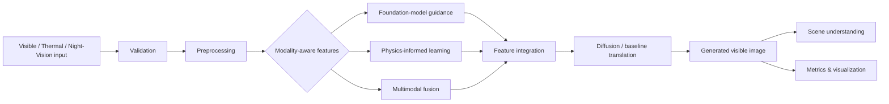

<!-- =========================== HERO =========================== -->

<div align="center">

#  Foundation Model–Guided Cross-Spectral Translation

### Physics-informed multimodal diffusion for visible–thermal image translation and scene understanding

<a href="https://github.com/narasimhulab-max/foundation-model-visible-thermal-translation"></a>
<a href="https://github.com/narasimhulab-max/foundation-model-visible-thermal-translation/stargazers"></a>
<a href="https://github.com/narasimhulab-max/foundation-model-visible-thermal-translation/blob/main/LICENSE"></a>
<a href="https://github.com/narasimhulab-max/foundation-model-visible-thermal-translation/issues"></a>

<br />

<a href="#-quick-start"><b>⚡ Quick Start</b></a>
&nbsp; • &nbsp;
<a href="#-baseline-results"><b>📊 Results</b></a>
&nbsp; • &nbsp;
<a href="#-architecture"><b>🏗️ Architecture</b></a>
&nbsp; • &nbsp;
<a href="Base_Model/Thermal_RGB_TRI2I/README.md"><b>📓 TRI2I Module</b></a>
&nbsp; • &nbsp;
<a href="#-roadmap"><b>🗺️ Roadmap</b></a>

</div>

---

## 🔍 What this project is building

A modular research pipeline that translates complementary information across visible, thermal, infrared, and night-vision domains—while preserving useful structural and semantic scene content.

The work combines:

- **Foundation-model guidance** for semantic context
- **Physics-informed learning** for modality-aware constraints
- **Multimodal feature fusion** across spectral representations
- **Diffusion-based generation** for cross-spectral translation
- **Scene understanding** for downstream interpretation
- **Software tooling** for validation, inference, visualization, and evaluation

> **Current status:** A reproducible Pix2Pix thermal-to-RGB baseline is implemented. Foundation-model guidance, the diffusion pipeline, and final scene-understanding integration remain active research and engineering work.

---

##  Key capabilities

<table>
<tr>
<td width="50%">

###  Thermal → RGB

Paired thermal-infrared to visible-spectrum translation using a Pix2Pix conditional GAN baseline.

</td>
<td width="50%">

###  Semantic guidance

A planned foundation-model-guided stage for richer scene understanding and feature preservation.

</td>
</tr>
<tr>
<td width="50%">

### 📐 Physics-aware learning

Explores constraints linked to imaging physics and cross-domain relationships.

</td>
<td width="50%">

###  Interactive pipeline

A Streamlit interface for image upload, modality selection, validation, and future model inference.

</td>
</tr>
<tr>
<td width="50%">

###  Quantitative evaluation

MAE, PSNR, SSIM, and LPIPS-oriented assessment of reconstructed images.

</td>
<td width="50%">

### 🧩 Modular design

Research experiments, software modules, documentation, and results remain separable and reusable.

</td>
</tr>
</table>

---

## 🏗️ Architecture



### Repository map

| Area | Purpose |
|---|---|
| [`Base_Model/`](Base_Model/) | Baseline models and experimental reference outputs |
| [`Base_Model/Thermal_RGB_TRI2I/`](Base_Model/Thermal_RGB_TRI2I/) | Pix2Pix thermal-to-RGB experiment and TRI2I workflow |
| [`Base_Model/results/`](Base_Model/results/) | Checkpoint comparisons and evaluation summaries |
| [`Software_Engineer/`](Software_Engineer/) | Streamlit UI, input handling, inference, evaluation, and tests |
| [`Software_Engineer/docs/`](Software_Engineer/docs/) | Architecture, requirements, interfaces, and data flow |
| [`documents/`](documents/) | Supporting project documents |

---

## 📊 Baseline results

The current TRI2I benchmark used **14,882 paired validation images** to compare four saved checkpoints.

| Checkpoint | MAE ↓ | PSNR ↑ | SSIM ↑ |
|---|---:|---:|---:|
| Baseline Epoch 1 | 0.101973 | 16.0545 dB | 0.477500 |
| Baseline Epoch 2 | 0.088573 | 16.8708 dB | 0.508279 |
| **Baseline Latest** | 0.086238 | **17.0482 dB** | 0.506095 |
| Resume Latest | **0.085606** | 16.9864 dB | 0.498972 |

### Held-out test evaluation

A previously recorded **Resume Latest** test run evaluated **14,884 images**:

- **MAE:** `0.085790`
- **PSNR:** `16.9817 dB`
- **SSIM:** `0.498237`

<details>
<summary><b>How to interpret these results</b></summary>

- Baseline Latest achieved the highest validation PSNR.
- Resume Latest achieved the lowest validation MAE.
- Epoch 2 achieved the highest validation SSIM.
- Metrics reward different aspects of quality and should not be interpreted as proof of semantic correctness.
- The test metrics above belong to Resume Latest; held-out evaluation of Baseline Latest remains pending.

</details>

<p align="right"><a href="Base_Model/results/TRI2I_checkpoint_validation_comparison.csv">📁 View validation CSV</a> · <a href="Base_Model/results/TRI2I_Thermal_RGB_test_summary.txt">📄 View test summary</a></p>

---

## ⚡ Quick start

### 1. Clone the repository

```bash
git clone https://github.com/narasimhulab-max/foundation-model-visible-thermal-translation.git
cd foundation-model-visible-thermal-translation
```

### 2. Install the software module dependencies

```bash
cd Software_Engineer
python -m venv .venv

# macOS / Linux
source .venv/bin/activate

# Windows
.venv\Scripts\activate

pip install -r requirements.txt
```

### 3. Launch the Streamlit interface

```bash
streamlit run ui/app.py
```

The interface currently supports:

- Thermal / infrared and night-vision modality selection
- JPG, JPEG, and PNG uploads
- Image validation and metadata display
- A future-ready inference and visualization stage

> The trained model is not yet connected to the Streamlit inference button. Large datasets and model weights are not included in this repository.

### 4. Run tests

```bash
cd Software_Engineer
pytest
```

---

##  TRI2I baseline workflow

The primary baseline follows a paired image translation setup:

```text
Thermal input  ──>  Pix2Pix U-Net 256  ──>  Generated RGB
                       +
                 PatchGAN discriminator
                       |
                 L1 + adversarial loss
```

| Setting | Current baseline |
|---|---|
| Dataset | TRI2I paired image dataset |
| Task | Thermal infrared → visible RGB |
| Generator | U-Net 256 |
| Discriminator | PatchGAN |
| Resolution | 256 × 256 |
| Input / output | 3 channels |
| Batch size | 4 |
| L1 loss weight | 100 |
| Optimizer | Adam |
| Initial learning rate | `0.0002` |

The TRI2I archive contains **148,829** verified pairs, prepared with a deterministic seed-42 split:

- **Training:** 119,063
- **Validation:** 14,882
- **Test:** 14,884

For full methodology and limitations, see the [TRI2I module documentation](Base_Model/Thermal_RGB_TRI2I/README.md).

---

## 🗺️ Roadmap

- [ ] Connect trained checkpoints to the Streamlit inference pipeline
- [ ] Complete held-out test evaluation for Baseline Latest
- [ ] Add representative qualitative image comparisons
- [ ] Implement reverse visible/RGB → thermal translation
- [ ] Integrate foundation-model feature guidance
- [ ] Add physics-informed constraints
- [ ] Develop diffusion-based generation experiments
- [ ] Add object/person detection and scene-understanding evaluation
- [ ] Extend the demonstration to batch and video processing
- [ ] Prepare reproducible environment and model release documentation

---

## ⚠️ Limitations & responsible use

Cross-spectral translation is not color recovery. Generated outputs may contain:

- Plausible but physically inaccurate colors
- Dark regions or missing texture
- Blur and reconstruction artifacts
- Incorrect fine structural details
- Dataset-dependent performance biases

Generated images should **not** be treated as ground truth or used for safety-critical decisions. Evaluate performance with appropriate test data and domain expertise.

---

## 📚 Documentation

- [TRI2I thermal-to-RGB baseline](Base_Model/Thermal_RGB_TRI2I/README.md)
- [Software requirements](Software_Engineer/docs/software_requirements.md)
- [Software architecture](Software_Engineer/docs/software_architecture.md)
- [Data flow](Software_Engineer/docs/data_flow.md)
- [Inference design](Software_Engineer/docs/inference.md)
- [Module interfaces](Software_Engineer/docs/module_interfaces.md)
- [Validation checkpoint comparison](Base_Model/results/TRI2I_checkpoint_validation_comparison.csv)

---

##  Contributing

Contributions are welcome in the following areas:

1. Reproducible training and inference scripts
2. Dataset preparation and validation utilities
3. Model improvements and ablation studies
4. Quantitative and qualitative evaluation
5. Streamlit interface improvements
6. Documentation, tests, and security reviews

Before submitting a pull request:

- Keep datasets and large model weights outside version control unless redistribution is permitted.
- Record the checkpoint and configuration associated with every result.
- Add tests for software modules.
- Clearly distinguish experimental claims from implemented functionality.

---

## 📄 License

This project is licensed under the **MIT License**.

See [`LICENSE`](LICENSE) for the full license text.

<div align="center">

**Built for research, experimentation, and transparent cross-spectral AI development.**

<a href="#foundation-modelguided-cross-spectral-translation">⬆️ Back to top</a>

</div>
